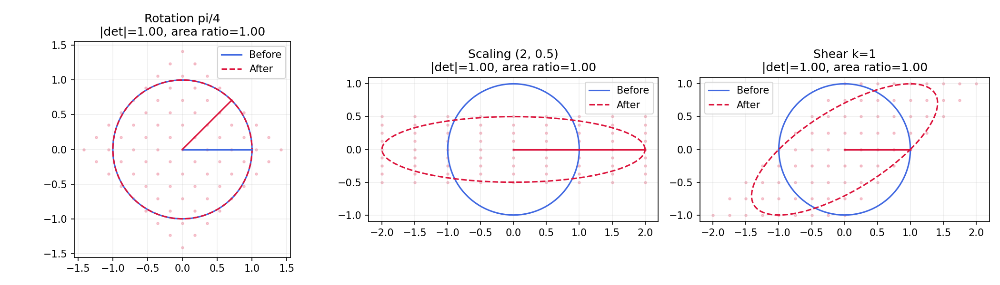
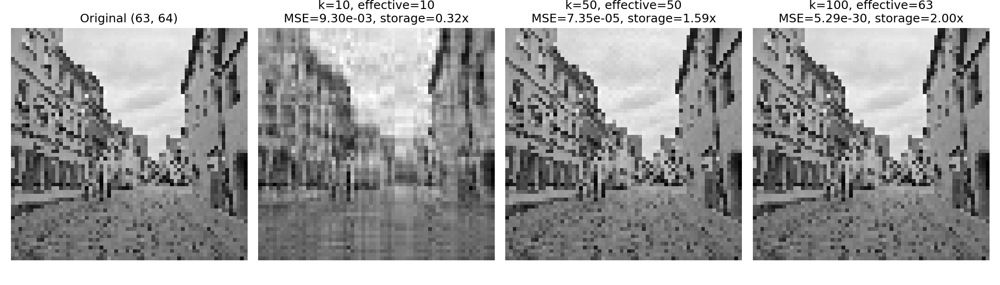
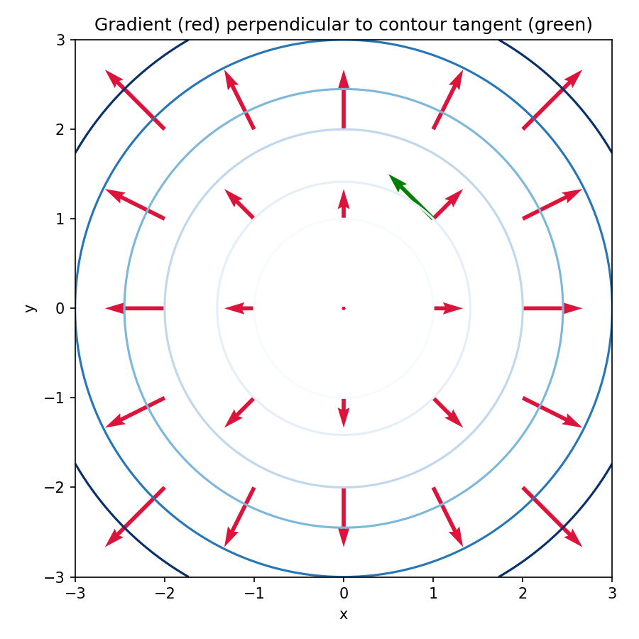
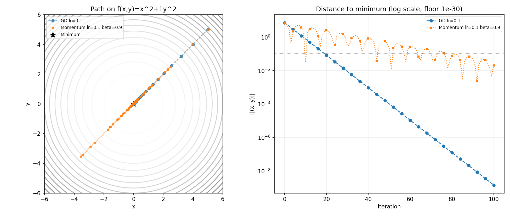
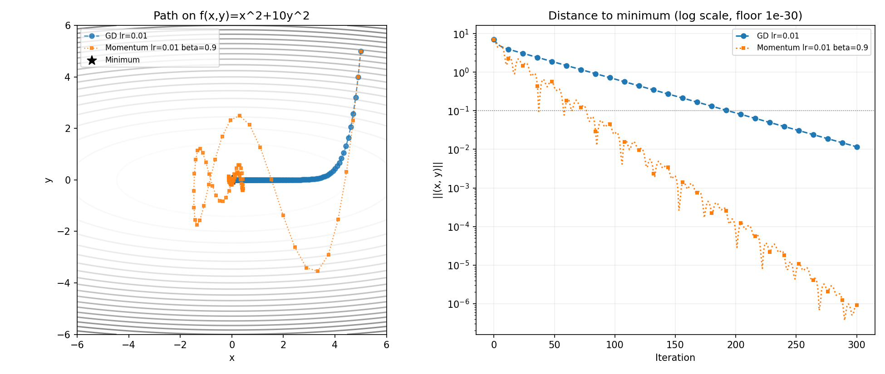
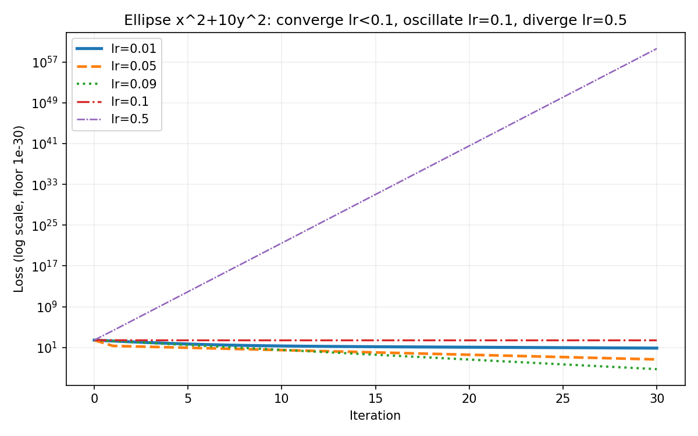
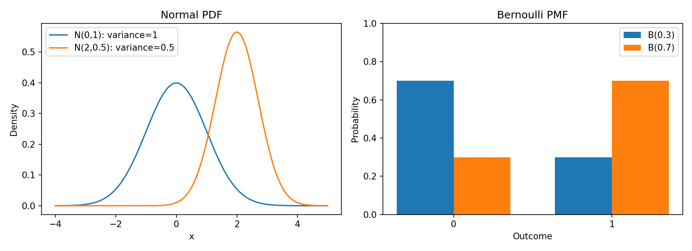

# 🟩 Math from Scratch for AI  

<br><br>

## 🟢 1. 프로젝트 소개  

AI(Artificial Intelligence, 인공지능)가 학습할 때 사용하는 수학을 NumPy로 직접 계산하는 과제다. 행렬이 공간을 바꾸는 과정, 손실을 미분하는 과정, 기울기로 가중치를 바꾸는 과정, 확률에서 손실 함수가 나오는 이유를 연결한다.  

수학 구현에는 NumPy만 사용한다. Matplotlib은 그림과 이미지 입출력을 담당한다. Jupyter 도구는 노트북 실행·표시용이며 자동 미분이나 수학 알고리즘을 대신하지 않는다.  

처음이라면 [그림으로 배우는 AI 수학 안내서](_practice/38_AI수학_그림으로_이해하기.html)를 브라우저에서 열고 순서대로 읽어보자. 이 안내서는 로컬 실습 자료이며 `_practice` 폴더는 현재 Git 추적에서 제외되어 있다.  

<br><br>

## 🟢 2. 실행하기  

이미 `uv init --python 3.11` 방식으로 초기화된 프로젝트다. 이 폴더에서 다시 초기화할 필요가 없다. Python 3.11을 기준으로 버전이 잠긴 환경을 사용한다.  

```sh
uv sync  
uv run main.py  
uv run python -m unittest discover -s tests -v  
uv run python scripts/execute_notebooks.py  
uv run python scripts/check_project.py  
```

| 명령 요소 | 풀네임 또는 뜻 | 하는 일 |  
| --- | --- | --- |
| uv | 공식 약자 풀네임이 없는 도구 이름 | Python 버전과 패키지 환경 관리 |  
| sync | synchronize, 동기화 | uv.lock과 같은 패키지 환경 설치 |  
| run | 실행 | 프로젝트 환경에서 프로그램 실행 |  
| python | Python 언어 실행기 | 코드를 실행 |  
| -m | module | 지정한 모듈을 프로그램으로 실행 |  
| unittest | unit test | Python 기본 테스트 도구 |  
| discover | 찾기 | 테스트 파일을 자동 검색 |  
| -s tests | start directory | tests 폴더부터 검색 |  
| -v | verbose | 각 테스트 결과를 자세히 표시 |  

첫 `sync`에는 공개 패키지 다운로드가 필요하다. 설치 후 수학 실험은 API(Application Programming Interface, 응용 프로그램 인터페이스) 키나 외부 서비스 연결 없이 수행한다.  

<br>

### 🟡 이미지 선택  

```sh
uv run main.py --synthetic  
uv run main.py --image data/europe.png  
uv run main.py --synthetic --output-dir outputs/generated  
uv run main.py --output-dir outputs/test261122  
```

| 옵션 | 뜻 |  
| --- | --- |
| --synthetic | 직접 생성한 64×64 이미지를 사용 |  
| --image | 지정한 로컬 PNG(Portable Network Graphics) 사용 |  
| --output-dir | 그림과 JSON(JavaScript Object Notation) 결과의 저장 폴더 |  

기본 실행은 `data/europe.png`가 있으면 사용하고 없으면 직접 생성한 예제 이미지를 사용한다. 제공 이미지는 종횡비를 유지하며 긴 쪽이 64 이하인 흑백 행렬로 바꾼다. 원본 파일은 바꾸지 않는다. 지정한 이미지가 없으면 오류를 낸다.  

<br>

### 🟡 노트북 직접 열기 (VS Code)  

VS Code(Visual Studio Code) 확장으로 노트북을 연다. 브라우저용 Jupyter Lab은 쓰지 않아도 된다.  

1. VS Code 확장 탭에서 Microsoft의 `Python`과 `Jupyter` 확장을 설치한다.  
2. 위의 `uv sync`를 먼저 실행한다. 프로젝트 안에 `.venv`(virtual environment, 가상 환경) 폴더가 생기고, 노트북 실행에 필요한 `ipykernel`(IPython kernel)도 함께 설치된다.  
3. VS Code에서 **File → Open Folder**로 프로젝트 루트(`main.py`가 있는 폴더)를 연다.  
4. `notebooks/backprop_derivation.ipynb`를 연다. `ipynb`는 IPython Notebook 파일이다.  
5. 오른쪽 위 **Select Kernel → Python Environments → `.venv` (Python 3.11)**를 고른다. 커널(kernel)은 셀의 코드를 실제로 실행하는 프로그램이다.  
6. 위쪽 **Run All**을 누르거나, 셀을 고르고 `Shift`+`Enter`로 하나씩 실행한다.  

노트북은 프로젝트 루트나 `notebooks` 폴더 어디에서 실행해도 `src`를 찾도록 첫 셀에서 위치를 확인한다. 세 노트북 전체 자동 실행은 위의 `scripts/execute_notebooks.py` 명령을 사용한다.  

<br><br>

## 🟢 3. 파일 역할  

| 파일 또는 폴더 | 역할 |  
| --- | --- |
| docs/requirement.md | 원본 요구사항. 변경하지 않음 |  
| main.py | 이미지·출력 옵션을 읽고 전체 실험 시작 |  
| src/linear_algebra.py | 변환, 면적, Power Iteration, SVD와 시각화 진입 함수 |  
| src/calculus.py | 중심차분, 편미분, Hessian, Gradient 시각화 진입 함수 |  
| src/backprop.py | 2→2→1 신경망 순전파·역전파·독립 기울기 검사 |  
| src/optimizer.py | GD, Momentum, Adam, Newton과 수렴 경로 시각화 진입 함수 |  
| src/probability.py | PDF, PMF, Sigmoid, Softmax, BCE, 엔트로피, KL |  
| src/visualization.py | 공통 그림 그리기와 PNG 저장 |  
| src/experiments.py | 실험 조건, 수치 판정, JSON 결과 생성 |  
| src/common.py | 빈 배열·차원·NaN·설정값 검사 |  
| notebooks/backprop_derivation.ipynb | 손계산, shape, 소수점 4자리 비교, 수치 기울기 재검증 |  
| notebooks/probability_loss.ipynb | 분포 그림과 Gaussian·Bernoulli·Categorical MLE 유도 |  
| notebooks/numerical_checks.ipynb | 미분 간격, 곡률, 최적화 조건과 추가 학습 |  
| tests/test_math.py | 독립 수식과 경계 조건, 전체 파일 생성을 검증 |  
| scripts/execute_notebooks.py | 실제 커널로 실행한 노트북 출력 저장 |  
| scripts/check_project.py | 코드 설명·금지 라이브러리·민감정보 패턴 검사 |  
| docs/requirement_review.md | 모순·빈 값의 처리 근거와 요구사항 대응표 |  
| docs/concepts.md | 용어와 추가 학습 순서 |  
| docs/validation.md | 실제 확인한 범위와 결과 |  
| _practice/ | 20번부터 짝수 순서의 따라 만드는 실습 (로컬 전용, Git 제외) |  
| _record/ | 변경 이유와 검증 결과의 상세 작업 기록 |  
| outputs/ | 실행으로 만든 PNG 13개와 summary.json (GitHub에서 바로 확인 가능하도록 Git 추적) |  
| pyproject.toml / uv.lock | 직접 의존성과 전체 설치 버전 잠금 |  
| requirements.txt | uv.lock에서 내보낸 실행용 패키지 버전 |  

<br>

### 🟡 모듈 분리 기준  

- 한 파일은 한 가지 수학 주제의 **계산**만 책임진다. `linear_algebra`는 행렬, `calculus`는 미분, `optimizer`는 이동 규칙, `probability`는 분포와 손실, `backprop`은 신경망 기울기를 맡는다.  
- 그림 코드는 `visualization.py` 한 곳에 모았다. 계산 함수는 그림 없이 테스트할 수 있고, 그림 모양을 바꿔도 계산 코드는 바뀌지 않는다.  
- 요구사항이 정한 위치(`src/linear_algebra.py`의 변환 시각화, `src/calculus.py`의 Gradient 시각화, `src/optimizer.py`의 수렴 경로 시각화)에는 같은 이름의 진입 함수를 두고 실제 그리기는 `visualization.py`에 맡긴다.  
- 실험 조건(시작점, 학습률, 반복 횟수)과 통과 판정은 `experiments.py`에 모았다. 수학 함수는 조건을 모르고, 실험 파일은 수학 공식을 다시 구현하지 않는다.  
- 입력 검사(빈 배열, NaN, 음수 학습률)는 `common.py`에서 공통으로 처리한다.  

<br><br>

## 🟢 4. 주요 결과  

기본 실험: 초기점 (5,5), seed=42. GD는 Gradient Descent(경사하강법), lr는 learning rate(학습률)다.  

| 항목 | 실제 계산 결과 |  
| --- | --- |
| 회전·스케일링·전단 면적비 | 각각 abs(det)와 오차 1% 이내 |  
| 최대 고유값 | 4.6180339887, NumPy 검증값과 상대 오차 5% 이내 |  
| 수치 미분 f'(3) | 6.000000000039, 절대 오차 약 3.93×10⁻¹¹ |  
| 출력 확률 | 0.6472915700 |  
| 은닉층 기울기 | [-0.0439785158, -0.0517335044] |  
| 전체 가중치·편향 중심차분 검사 | 최대 절대 오차 약 3.70×10⁻¹² |  
| 원형 GD, lr=0.1, 100회 | 원점 반경 약 1.44×10⁻⁹ |  
| 원형 GD, lr=1.1 | 30회 후 반경 약 1.68×10³, 발산 |  
| 타원형 GD, lr=0.5 | 매 단계 y가 -9배, 30회 후 반경 약 2.12×10²⁹, 발산 |  
| 타원형 같은 lr=0.01 비교 | GD 194회, Momentum(beta=0.9) 77회부터 반경 0.1 안 유지 → Momentum이 약 2.5배 빠름 |  
| 타원형 GD, lr=0.05 | 38회부터 마지막 단계까지 반경 0.1 안 유지 |  
| 타원형 Momentum, lr=0.05, beta=0.9 | 80회부터 마지막 단계까지 반경 0.1 안 유지 (관성이 진동을 만드는 반례) |  
| 타원형 곡률에 맞춘 Momentum | 11회부터 마지막 단계까지 반경 0.1 안 유지 |  
| 정확한 Hessian을 쓴 Newton | 이번 이차 함수에서 1회 만에 원점 도달 |  
| Softmax [1000,1001,1002] | 합 오차 1e-6 이내 |  

지속 수렴 단계는 기록한 경로의 마지막까지 반경을 유지한 최초 단계다. 무한히 긴 미래에 대한 별도 증명이라는 뜻은 아니다.  

Momentum이 빠른 이유: 타원형 함수에서 x 방향은 기울기가 작다(2x). 작은 lr의 GD는 x 방향으로 한 번에 2%씩만 줄어든다. Momentum은 같은 방향의 기울기를 속도 v에 계속 쌓아서 완만한 방향의 이동 거리를 최대 약 1/(1-beta)=10배까지 키운다. 기울기가 큰 y 방향은 부호가 바뀌는 기울기끼리 서로 상쇄된다. 곡률 차이가 큰 타원형 함수일수록 이 차이가 두드러진다. 반대로 lr=0.05처럼 GD가 이미 y 방향을 한 번에 없애는 설정에서는 관성이 오히려 진동을 만든다. 그래서 두 설정을 모두 기록했다.  

실행하면 터미널에 det와 면적비, 고유값 오차, 미분 오차, 최적화 반경, 역전파 체크포인트, Softmax 합 오차가 숫자로 먼저 출력된다. 그 다음 14개 판정이 PASS/FAIL로 출력된다.  

<br>

### 🟡 그림 목록  

| PNG 파일 | 확인할 내용 |  
| --- | --- |
| transformations.png | 원과 방향 기준선·격자의 회전, 확대/축소, 전단 |  
| svd_comparison.png | 원본과 k=10,50,100 복원, 실제 rank와 저장량 |  
| gradient.png | 등고선의 접선과 기울기의 수직 관계 |  
| optimization_circle.png | 원형 함수의 GD·Momentum 점선 경로(왼쪽)와 원점까지 거리(오른쪽) |  
| learning_rates.png | 원형 함수 lr=0.1,0.5,0.9,1.0,1.1 손실 비교 (0.1과 0.9는 같은 곡선) |  
| divergence_path.png | 원형 함수 lr=1.1의 발산 경로 |  
| learning_rates_ellipse.png | 타원형 함수 lr=0.01,0.05,0.09,0.1,0.5 손실 비교, lr=0.5 발산 |  
| divergence_ellipse_lr05.png | 타원형 함수 lr=0.5의 발산 경로 |  
| optimization_ellipse.png | 같은 lr=0.01에서 타원형 GD·Momentum 경로, Momentum이 더 빠름 |  
| optimization_ellipse_lr005.png | lr=0.05에서 타원형 GD·Momentum 경로, Momentum이 진동하는 반례 |  
| momentum_tuned.png | 곡률을 고려한 Momentum의 추가 비교 |  
| optimizer_comparison.png | GD·Momentum·Adam·Newton 손실 비교 |  
| probability_distributions.png | 두 정규분포 PDF와 두 Bernoulli PMF |  
| finite_difference_errors.png | 추가 노트북에서 만드는 미분 간격별 오차 |  

`summary.json`은 반경, 기울기, 오차, rank, 14개 수치 판정을 담는다. 실패 항목이 있으면 전체 실행도 실패한다. JSON과 그래프는 함께 확인한다.  

<br>

### 🟡 대표 그림  

| 그림 | 확인할 내용 |  
| --- | --- |
|  | 회전·스케일링·전단, 제목에 \|det\|와 면적비 |  
|  | k=10, 50, 100 복원 비교 |  
|  | 빨간 Gradient가 초록 접선과 수직 |  
|  | 원형 함수 GD·Momentum 경로 |  
|  | 같은 lr에서 Momentum의 이점 |  
|  | 타원형 lr=0.5 발산 |  
|  | 정규 PDF 2종, 베르누이 PMF 2종 |  

<br>

### 🟡 실행 결과를 눈으로 확인하기  

1. 위의 기본 실행 명령이 끝나면 터미널에서 `PASS`가 표시된 항목과 마지막 완료 문구를 확인한다. `PASS`는 해당 수치 검사를 통과했다는 뜻이다.  
2. Finder에서 이 프로젝트 폴더를 열고 `outputs` 폴더로 들어간다. 그림 파일을 더블 클릭하면 기본 이미지 보기 앱에서 열 수 있다.  
3. 처음에는 `transformations.png`에서 원이 어떻게 바뀌는지 보고, `gradient.png`에서 기울기 화살표를 확인한다. 이어서 `optimization_circle.png`의 점선을 따라가면 원점으로 이동하는 과정을 볼 수 있다.  
4. `summary.json`은 텍스트 편집기로 열어 수치와 검사 결과를 확인한다. `true`는 검사 통과, `false`는 검사 실패를 뜻한다. 그림의 모양과 숫자를 함께 살펴본다.  

기본 실험은 `outputs` 안에 그림 13개와 `summary.json`을 저장한다. 추가 노트북을 실행하면 미분 간격을 비교하는 `finite_difference_errors.png`도 생긴다. 같은 출력 폴더에 다시 실행하면 이름이 같은 결과는 덮어쓴다. 별도 폴더가 필요하면 위의 `--output-dir` 예시를 사용한다.  

<br><br>

## 🟢 5. 요구사항을 읽을 때 주의할 내용  

- `y_true`는 비어 있어 원문 결과 예시의 1을 사용했다.  
- `f=x²+y²`에서 `lr=0.5`는 한 단계에 원점으로 간다. 수렴 범위는 `0<lr<1`, `lr=1`은 진동, `lr>1`은 발산이다. 원문의 "lr≥0.5 발산"은 타원형 함수 `f=x²+10y²`에서 성립한다(`0<lr<0.1`에서만 수렴). 두 함수의 발산 그래프를 모두 저장했다.  
- 원문 예시의 lr=0.05 타원형 비교에서는 GD가 y 방향을 한 단계에 없애므로 Momentum이 더 느리다. 같은 lr=0.01 비교에서 Momentum의 이점을 확인하고, lr=0.05 결과는 반례로 함께 기록했다.  
- 64 이하 이미지에서 k=100은 가능한 최대 rank로 제한된다. 실제 제공 이미지의 전처리 크기는 63×64라 최대 rank가 63이다.  
- SVD의 저장량은 같은 자료형의 원소 수 기준이다. 높은 rank는 PNG 파일을 더 작게 만든다는 보장이 없다.  
- Power Iteration은 실수 대칭 행렬의 지배 고유쌍을 구한다. 조건과 한계는 별도 문서에 적었다.  
- 원문 예시의 일부 반올림 값은 정확한 결과와 다르다. 원문은 그대로 두고 노트북에서 정확한 식으로 검증했다.  

자세한 이유는 [요구사항 검토](docs/requirement_review.md)에 있다.  

<br><br>

## 🟢 6. 보안과 제출  

- 프로그램은 `.env`를 읽지 않고 API 키를 요구하지 않는다.  
- `.gitignore`는 비밀 파일, 가상 환경, 원본 데이터, 생성 결과를 제외한다.  
- Docker는 허용한 코드와 requirements.txt만 복사하며 `.env`를 자동으로 읽지 않는다.  
- 노트북 실행 출력에 사용자 개인 절대 경로가 있으면 저장을 중단한다.  
- `outputs/` 바로 아래의 PNG와 `summary.json`은 평가자가 GitHub에서 볼 수 있게 Git에 포함한다. 하위 폴더(`outputs/generated` 등)는 제외한다.  
- `_practice`, `_record`는 로컬 학습 기록이라 Git에서 제외한다.  
- `svd_comparison.png`는 `data/europe.png`를 63×64 흑백으로 줄인 결과다. 원본 이미지의 배포 권한을 확인하기 어렵다면 `uv run main.py --synthetic`으로 다시 만든 그림을 올린다.  
- `data/europe.png`의 원본 출처·배포 권한은 확인하지 않았다. 원본 이미지는 Git에 추가하지 않는다. 다른 환경은 직접 생성 예제로 재현할 수 있다.  
- GitHub 레포지토리 URL 제출은 저장소를 게시한 뒤 할 수 있다. 이 작업은 로컬 구현과 검증까지이며 원격 게시를 수행하지 않았다.  

<br><br>

## 🟢 7. 원문 자료  

- 환경과 실행: [uv 프로젝트 문서](https://docs.astral.sh/uv/guides/projects/)  
- SVD의 배열 크기와 복원: [NumPy SVD 문서](https://numpy.org/doc/stable/reference/generated/numpy.linalg.svd.html)  
- 확률적 손실 해석과 역전파: [Stanford CS229 강의 노트](https://cs229.stanford.edu/main_notes.pdf)  
- Adam 알고리즘: [Adam 원 논문](https://arxiv.org/abs/1412.6980)  
- Gradient와 Newton: [Convex Optimization 교재](https://web.stanford.edu/~boyd/cvxbook/)  
